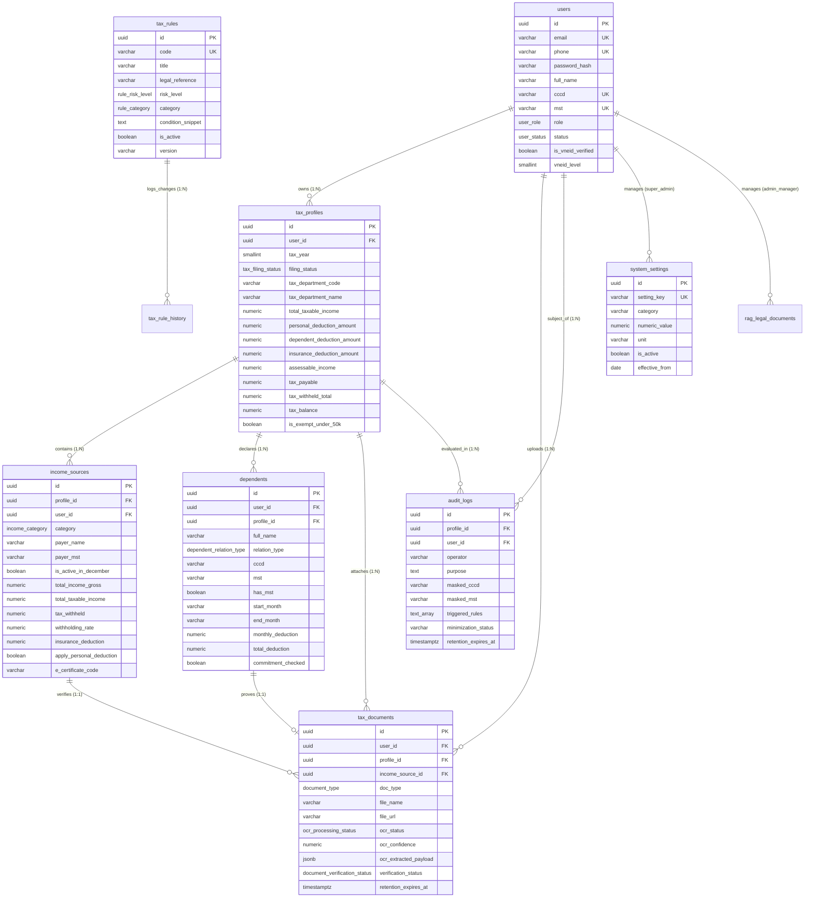

# THIẾT KẾ SCHEMA CƠ SỞ DỮ LIỆU POSTGRESQL - HỆ THỐNG THUTRA TNCN

Tài liệu thiết kế kiến trúc cơ sở dữ liệu PostgreSQL cho Hệ thống **ThuTra TNCN** (Thẩm tra và Quyết toán Thuế Thu nhập Cá nhân), tuân thủ tiêu chuẩn bảo mật dữ liệu cá nhân theo **Nghị định 13/2023/NĐ-CP**, kiểm soát truy cập theo vai trò (**RBAC** 3 cấp) và chính sách phân quyền mức dòng (**Row-Level Security - RLS**).

---

## 1. MÔ HÌNH THỰC THỂ - MỐI KẾT HỢP (ERD)



---

## 2. MA TRẬN PHÂN QUYỀN RBAC & CHÍNH SÁCH RLS

| Bảng Cơ Sở Dữ Liệu | Vai trò `super_admin` | Vai trò `admin_manager` | Vai trò `user` (Người nộp thuế) | Cơ chế Bảo mật RLS |
| :--- | :---: | :---: | :---: | :--- |
| **`users`** | ALL (Toàn quyền) | SELECT (Danh bạ, trừ super_admin) | SELECT & UPDATE (Chỉ tài khoản của chính mình) | `rls_users_*` |
| **`tax_profiles`** | ALL (Giám sát tối cao) | **BỊ CHẶN HOÀN TOÀN** (0 dòng) | ALL (Chỉ hồ sơ của chính mình) | `rls_tax_profiles_*` |
| **`income_sources`** | ALL (Giám sát tối cao) | **BỊ CHẶN HOÀN TOÀN** (0 dòng) | ALL (Chỉ nguồn thu nhập của mình) | `rls_income_sources_*` |
| **`tax_documents`** | ALL (Giám sát tối cao) | **BỊ CHẶN HOÀN TOÀN** (0 dòng) | ALL (Chỉ chứng từ do mình tải lên) | `rls_tax_documents_*` |
| **`dependents`** | ALL (Giám sát tối cao) | **BỊ CHẶN HOÀN TOÀN** (0 dòng) | ALL (Chỉ người phụ thuộc của mình) | `rls_dependents_*` |
| **`tax_rules`** | ALL (Toàn quyền) | ALL (CRUD quản lý bộ quy tắc) | SELECT (Chỉ các rule `is_active = true`) | `rls_tax_rules_*` |
| **`system_settings`** | ALL (Sửa mức giảm trừ, lương cơ sở) | SELECT (Chỉ xem tham số) | SELECT (Chỉ xem tham số kích hoạt) | `rls_system_settings_*` |
| **`rag_legal_documents`**| ALL (Toàn quyền) | ALL (Nạp tài liệu, đồng bộ vector)| SELECT (Tra cứu văn bản pháp luật) | `rls_rag_docs_*` |
| **`audit_logs`** | ALL (Toàn quyền) | SELECT (Xem log đã ẩn danh CCCD/MST)| SELECT (Chỉ log liên quan đến bản thân) | `rls_audit_logs_*` |

---

## 3. DANH MỤC 15 QUY TẮC THẨM TRA THUẾ (R01 - R15) ĐÃ SEED

1. **R01**: Kiểm tra định dạng và MST người phụ thuộc (*Thông tư 80/2021/TT-BTC*) - Mức độ: **Warning**.
2. **R02**: Kiểm tra tính trùng lặp người phụ thuộc giữa các cá nhân kê khai (*Thông tư 111/2013/TT-BTC*) - Mức độ: **Error**.
3. **R03**: Kiểm tra ngưỡng thu nhập vãng lai được miễn khấu trừ 10% (*Thông tư 111/2013/TT-BTC*) - Mức độ: **Suggestion**.
4. **R04**: Tự động xác định CQT quyết toán theo nơi làm việc tháng 12 (*Điều 45 Thông tư 80/2021/TT-BTC*) - Mức độ: **Suggestion**.
5. **R05**: Xác định tính hợp lệ của khoản đóng góp bảo hiểm bắt buộc (*Luật BHXH 2014 & NĐ 73/2024*) - Mức độ: **Suggestion**.
6. **R06**: Kiểm tra điều kiện ủy quyền quyết toán thay tại tổ chức duy nhất (*Nghị định 126/2020/NĐ-CP*) - Mức độ: **Warning**.
7. **R07**: Rà soát chứng từ đóng góp từ thiện, nhân đạo hợp pháp (*Thông tư 111/2013/TT-BTC*) - Mức độ: **Suggestion**.
8. **R08**: Đối soát thu nhập vãng lai 10% với chứng từ điện tử e-Chungtu (*Nghị định 123/2020/NĐ-CP*) - Mức độ: **Error**.
9. **R09**: Đối soát chênh lệch thu nhập chịu thuế giữa Form 02/QTT và e-Chungtu (*Thông tư 80/2021/TT-BTC*) - Mức độ: **Error**.
10. **R10**: Phát hiện trùng lặp giảm trừ bản thân giữa 2 tổ chức chi trả (*Điều 9 Thông tư 111/2013/TT-BTC*) - Mức độ: **Error**.
11. **R11**: Xác thực tình trạng cư trú thuế (>= 183 ngày hoặc nơi ở thường xuyên) (*Thông tư 111/2013/TT-BTC*) - Mức độ: **Warning**.
12. **R12**: Cảnh báo vượt ngưỡng nộp phạt chậm quyết toán sau 02/05 (*Khoản 2 Điều 59 Luật QLT 2019*) - Mức độ: **Warning**.
13. **R13**: Kiểm tra giới hạn trần đóng quỹ hưu trí tự nguyện (1.000.000 đ/tháng) (*NĐ 12/2015 & TT 111/2013*) - Mức độ: **Suggestion**.
14. **R14**: Miễn nghĩa vụ nộp thuế quyết toán khi phát sinh thêm từ 50.000 VNĐ trở xuống (*Điểm e Khoản 2 Điều 8 NĐ 126/2020*) - Mức độ: **Suggestion**.
15. **R15**: Kiểm tra tính đồng bộ tài khoản Định danh điện tử VNeID và eTax Mobile (*Nghị định 59/2022/NĐ-CP*) - Mức độ: **Warning**.

---

## 4. HƯỚNG DẪN THỰC THI MIGRATION & KIỂM THỬ

### 4.1. Chạy Migration trên PostgreSQL
```bash
psql -U postgres -d thutra_tncn_db -f database/migrations/20261026_000001_thutra_tncn_schema.sql
```

### 4.2. Chạy Kịch bản kiểm thử Row-Level Security
```bash
psql -U postgres -d thutra_tncn_db -f database/test_rls_security.sql
```
